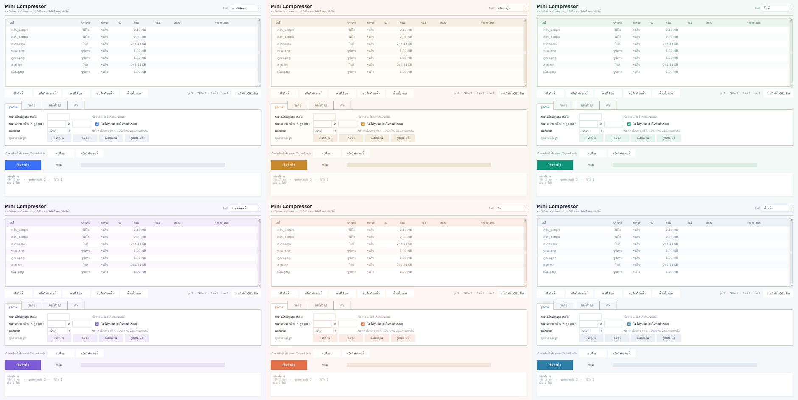
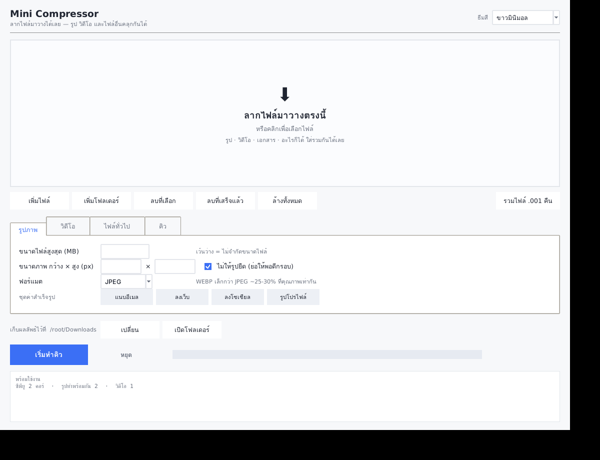
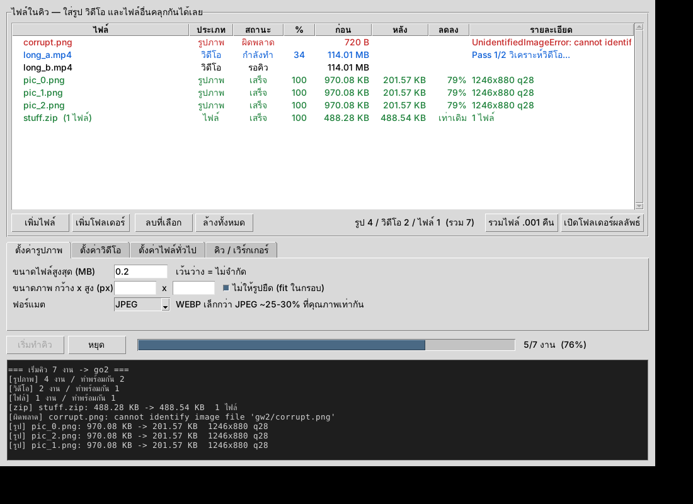

# Mini Compressor

แอปบีบอัดไฟล์บนเดสก์ท็อป เขียนด้วย Python + tkinter
โยน **รูป วิดีโอ และไฟล์อะไรก็ได้เข้าไปคลุกกันในลิสต์เดียว** แอปแยกประเภทให้เองตามนามสกุล
แล้วทำงานเป็นคิวที่ขนานกันตามประเภท

> A desktop file compressor in Python + tkinter. Drop images, videos and any other
> files into one list — it routes each by type and runs them through a queue with
> per-type parallelism. Target file size is enforced by binary search (images) and
> two-pass bitrate calculation (video).



---

## ทำอะไรได้

| โหมด | ความสามารถ |
|---|---|
| **รูปภาพ** | กำหนดขนาดไฟล์สูงสุดเป็น MB และ/หรือกำหนดขนาดภาพ กว้าง × สูง · JPEG / WEBP / PNG · หมุนตาม EXIF ให้เอง |
| **วิดีโอ** | กำหนดขนาดไฟล์สูงสุดได้แม่น ด้วย two-pass x264 · ย่อความละเอียดได้ · มี % ความคืบหน้าจริง |
| **ไฟล์ทั่วไป** | รวบเป็น zip ก้อนเดียว (deflate 9) · หั่นเป็นส่วนย่อยตามขนาดที่กำหนด + ปุ่มรวมคืน |

ลากไฟล์มาวางได้ · 6 ธีมสีอ่อนสลับได้ทันที · จำค่าที่ตั้งไว้ให้ครั้งหน้า ·
หยุดกลางคันได้จริง (ฆ่า ffmpeg ที่กำลังวิ่ง ไม่ทิ้งไฟล์ขยะ)



---

## ติดตั้ง

```bash
pip install -r requirements.txt
```

โหมดวิดีโอต้องมี `ffmpeg` ในเครื่องด้วย (ติดตั้งแยกจาก pip):

```bash
winget install ffmpeg      # Windows — ลงเสร็จต้องเปิด terminal ใหม่
brew install ffmpeg        # macOS
sudo apt install ffmpeg    # Linux
```

Linux บางดิสโทรต้องลง tkinter เพิ่ม: `sudo apt install python3-tk`

## รัน

```bash
python compressor.py
```

## ทำเป็น .exe

```bash
pip install pyinstaller
pyinstaller --onefile --windowed --name MiniCompressor compressor.py
```

ได้ไฟล์ที่ `dist/MiniCompressor.exe` — ffmpeg ไม่ถูกรวมเข้าไป ยังต้องมีในเครื่อง

---

## คิว + ทำพร้อมกัน

สองอย่างนี้ไม่ใช่ทางเลือกคนละทาง มันคือของชิ้นเดียวกัน:
**คิวไม่จำกัดความยาว + ตัวเลขจำกัดว่าดึงออกมาทำพร้อมกันทีละกี่งาน**

แต่ค่าของรูปกับวิดีโอต้องไม่เท่ากัน — วัดบนเครื่องจริงมาแล้ว:

| | 1 พร้อมกัน | 2 พร้อมกัน | 4 พร้อมกัน |
|---|---|---|---|
| รูป 8 ใบ (4000×3000) | 6.17 s | **5.42 s** | 5.53 s |
| วิดีโอ 4 คลิป (720p) | 11.8 s | 10.1 s | **10.6 s ← เริ่มช้าลง** |

- **รูปขนานได้จริง** — Pillow เข้ารหัสด้วยโค้ด C ที่ปล่อย GIL
  (ตัวควบคุม: pure Python loop ได้ 1.00× เป๊ะ / Pillow resize ได้ 1.43× บนเครื่อง 2 คอร์)
  ค่าเริ่มต้นจึงเท่ากับจำนวนคอร์ เพดาน 6
- **วิดีโอขนานไม่ได้** — ffmpeg ใช้ครบทุกคอร์อยู่แล้วในตัวมันเอง
  เปิดหลายตัวพร้อมกันคือแย่งคอร์กันเอง + กิน RAM หลายเท่า ค่าเริ่มต้นจึงเป็น 1

**แยกพูลตามประเภท ไม่ใช้พูลรวม** เพราะถ้าใช้พูลรวมแล้วจำกัดวิดีโอด้วย semaphore
พอมีวิดีโอหลายคลิปเข้าคิว เธรดทุกตัวจะไปนอนรอ semaphore กันหมด
รูปที่ต่อคิวข้างหลังจะไม่ได้ทำเลยทั้งที่ยังว่าง (starvation)



---

## วิธีกำหนดขนาดไฟล์ให้ได้จริง

**รูป** — binary search หา quality สูงสุดที่ยังไม่เกินเป้า (~7 รอบ แทนไล่ทีละ 1 ที่ต้อง 75 รอบ)
ถ้าลด quality จนต่ำสุดแล้วยังเกิน จะย่อพิกเซลช่วย โดยคำนวณอัตราย่อจาก
`sqrt(เป้า / ขนาดจริง) × 0.92` เพราะขนาดไฟล์แปรผันตามจำนวนพิกเซล (= ด้าน²)

ผลวัดจริง ไม่เคยเกินเป้า:

| | 2 MB | 0.5 MB | 0.2 MB | 0.05 MB | 0.01 MB |
|---|---|---|---|---|---|
| JPEG | 1.99 MB | 503 KB | 202 KB | 51 KB | 10.2 KB |
| WEBP | 1.99 MB | 505 KB | 203 KB | 50 KB | 10.2 KB |
| PNG  | 1.31 MB | 508 KB | 204 KB | 51 KB | 10.2 KB |

**วิดีโอ** — `bitrate = ขนาดเป้าหมาย(kbit) / ความยาว(วินาที)` แล้วเข้ารหัส two-pass
รอบแรกสแกนดูว่าฉากไหนยาก/ง่าย รอบสองค่อยแบ่ง bitrate ให้แม่น
ผลวัดจริง: สั่ง 5 MB ได้ 4.68 MB · สั่ง 2 MB ได้ 1.86 MB (~93-95% ของเป้า)

**ไฟล์ทั่วไป** — การันตีขนาดหลังบีบ **ไม่ได้** jpg / mp4 / exe ถูกบีบมาแล้วจึงแทบไม่ลดเลย
การหั่นเป็นส่วนย่อยจึงเป็นวิธีเดียวที่ทำให้ "ทุกไฟล์ไม่เกิน X MB" ได้จริง

---

## โครงสร้างโค้ด

| ไฟล์ | หน้าที่ |
|---|---|
| `engine.py` | ตรรกะทั้งหมด **ไม่มี GUI เลย** — ฟังก์ชันบีบอัด + `Job` + `Engine` |
| `compressor.py` | หน้าตา อ่านค่าจากช่องกรอกแล้วส่งเข้า engine |
| `theme.py` | ชุดสี + การทาสี ttk + ช่องติ๊กที่วาดเอง |

แยกแบบนี้เพราะเทสต์ `engine.py` ได้โดยไม่ต้องเปิดหน้าต่าง และยกไปทำ CLI หรือเว็บต่อได้ทั้งก้อน:

```python
import engine as E

# ใช้ทีละไฟล์
E.compress_image("in.jpg", "out.jpg", target_mb=0.5, width=1920, height=1080)

# หรือใช้คิวทั้งก้อน
st = E.default_settings("out/")
st["img"]["target_mb"] = 0.3
jobs = E.Engine.build_jobs(["a.png", "b.mp4", "c.pdf"])
E.Engine(st, workers={"img": 4, "vid": 1}).start(jobs, block=True)
for j in jobs:
    print(j.label, j.status, E.human(j.after))
```

งานทุกอย่างรันในเธรดแยก หน้าต่างไม่ค้าง และส่งข้อความกลับผ่าน `queue`
เพราะ tkinter ห้ามแตะ widget จากเธรดอื่นโดยตรง

---

## เรื่องที่เจอระหว่างทำ

- **ธีม `clam` วาดช่องติ๊กที่ติ๊กแล้วเป็น ✗** ซึ่งสื่อผิดความหมาย และ tkinter เปลี่ยน glyph ไม่ได้
  → วาดกล่องกับเครื่องหมายถูกเองบน `Canvas`
- **PNG โหมดกำหนดขนาดเคยวนไม่รู้จบ** — การ resize รูปที่มี noise เยอะทำให้ไฟล์ PNG *ใหญ่ขึ้น*
  (945 KB → 1.47 MB) เพราะ interpolation สร้างสีใหม่ทำลาย palette ที่ quantize ไว้
  → ปิด dither แล้วคำนวณอัตราย่อจากขนาดไฟล์จริงแทนการลดทีละ 15%
- **ต้องสลับธีมฐาน ttk เป็น `clam`** ก่อนถึงจะทาสีได้ครบ เพราะธีมพื้นเมืองของ Windows
  ล็อกสีปุ่มกับตารางไว้
- **tkinter ทำมุมโค้งมนและเงาไม่ได้** ทุกอย่างเป็นสี่เหลี่ยมคม

---

## License

MIT — ดูไฟล์ [LICENSE](LICENSE)
